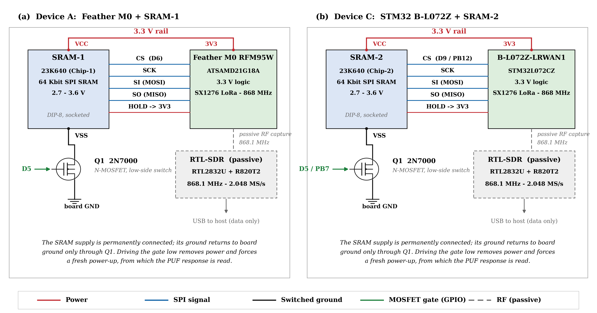
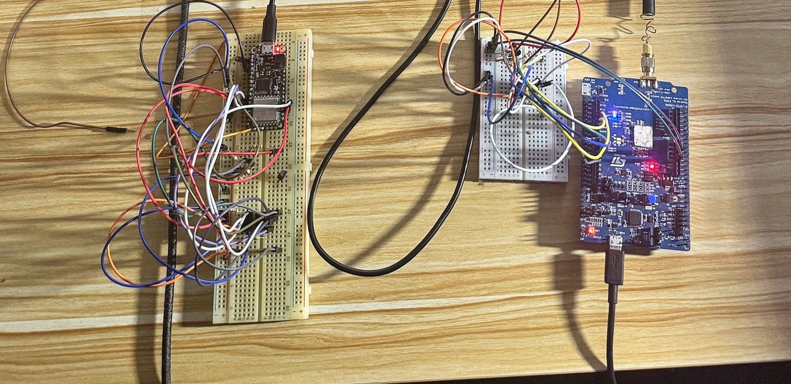

# LoRaWAN SRAM-PUF + RF Fingerprinting Testbed

Firmware and capture tools for a two-platform hardware testbed used in my PhD research on **hardware-rooted device authentication for low-power LoRaWAN IoT nodes** (University of Huddersfield, 2026).

The testbed captures two physical-layer identity signals from the same device:

- **SRAM Physical Unclonable Function (PUF):** the power-up state of an external SRAM chip, which is unique to each chip
- **RF fingerprint:** transmitter-specific characteristics (e.g. carrier-frequency offset) in the device's LoRa transmissions, captured with an RTL-SDR



## Hardware

| Component | Part |
|---|---|
| Device A | Adafruit Feather M0 RFM95W (ATSAMD21G18A, Cortex-M0+, SX1276 LoRa) |
| Device C | ST B-L072Z-LRWAN1 (STM32L072CZ, Cortex-M0+, SX1276 LoRa) |
| PUF source | Microchip 23K640 — 64 Kbit SPI SRAM (DIP-8, socketed) |
| Power switch | 2N7000 N-MOSFET, low-side switch on the SRAM ground |
| RF capture | RTL-SDR (RTL2832U + R820T2), 868.1 MHz, 2.048 MS/s |

The SRAM supply is permanently connected; its ground returns to board ground only through the MOSFET. Driving the gate low removes power and forces a fresh power-up, from which the PUF response is read. Swapping the socketed SRAM chips between the two host boards gives a **2×2 design** (2 host platforms × 2 SRAM chips), separating host-platform effects from chip identity.



## Repository layout

```
firmware/
  feather_sram_rff/   Arduino sketch for the Feather M0 (Device A)
  stm32_sram_rff/     Arduino (STM32duino) sketch for the B-L072Z-LRWAN1 (Device C)
capture/
  puf_logger.py       Serial logger: triggers captures and saves 8,192-byte PUF responses
  sdr_sniffer.py      RTL-SDR energy-triggered capture of LoRa bursts at 868.1 MHz
docs/                 Wiring diagram and testbed photo
```

## How it works

1. **Power cycle:** the firmware switches the SRAM off via the MOSFET (2 s off on the Feather, 4 s on the STM32 to let the rail fully discharge), then powers it on and waits 50 ms.
2. **Read:** the full 8,192 bytes (65,536 bits) are read over SPI and streamed to the host between `=== PUF DATA START ===` / `=== PUF DATA END ===` markers, followed by the bit bias.
3. **Transmit:** the device sends a short LoRa packet (`PUF_SYNC:<n>`) at 868.1 MHz so each PUF capture has a matching RF capture.
4. **Log:** `puf_logger.py` saves each response as a 256 × 32 binary text grid and a hex CSV; `sdr_sniffer.py` saves each detected LoRa burst as raw IQ samples (`.npy`).

Serial commands: `C1` / `C2` capture from SRAM chip 1 / 2, `S` prints status.

## Quick start

```bash
pip install -r requirements.txt
# 1. Flash the sketch for your board (Arduino IDE; requires the LoRa library by Sandeep Mistry)
# 2. Set PORT in capture/puf_logger.py, then:
python capture/puf_logger.py
# 3. With an RTL-SDR attached, in a second terminal:
python capture/sdr_sniffer.py
```

## Data and publications

- **Dataset:** full measurement data from this testbed is openly available — [Zenodo, DOI 10.5281/zenodo.19592147](https://doi.org/10.5281/zenodo.19592147) · [IEEE DataPort, DOI 10.21227/fecz-fe94](https://doi.org/10.21227/fecz-fe94)
- **Paper:** M. B. Aliyu, A. Johnson, "Complementary failure modes of SRAM-PUF and RF fingerprinting under compound thermal–distance stress in LoRaWAN sensor nodes: A device-level empirical study," *Ad Hoc Networks* (Elsevier), 2026. [doi:10.1016/j.adhoc.2026.104413](https://doi.org/10.1016/j.adhoc.2026.104413) (open access)
- **Conference:** M. B. Aliyu, M. Hafeez, A. Johnson, "LoRa-PUF: A Two-Step Security Solution for LoRaWAN," IEEE VTC2023-Spring. [doi:10.1109/VTC2023-Spring57618.2023.10199591](https://doi.org/10.1109/VTC2023-Spring57618.2023.10199591)

## Notes

- These are research lab sketches, not production firmware.
- The Feather sketch sets LoRa TX power to the radio maximum for close-range lab capture. Outside the lab, reduce it to stay within EU868 regulatory limits.

## Author

Dr Mohammed Bello Aliyu · [LinkedIn](https://linkedin.com/in/bello-aliyu-827462111)

Research supported by EPSRC Connected Everything Network Plus, EU Horizon MSCA EVOLVE and UKRI.

## Licence

Code released under the MIT Licence (see `LICENSE`).
